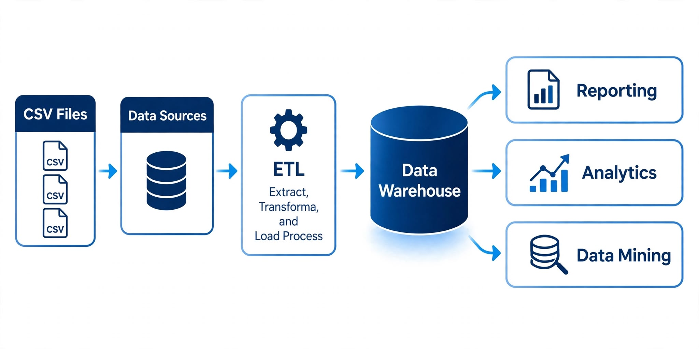

# E\-Commerce Data Warehouse

## Overview

This project demonstrates the design and implementation of an E\-Commerce Data Warehouse using DuckDB and SQL. The solution transforms raw transactional data into a structured Star Schema to support business reporting and analytics.

The project follows a typical data warehousing workflow, including data ingestion, staging, data quality validation, dimensional modelling, and fact table creation.

## Dataset

The warehouse is built using the following datasets:

- Customers
- Products
- Orders
- Order Items
- Payments

## Data Model

### Dimension Tables

- DimCustomer
- DimProduct
- DimDate

### Fact Table

- FactSales

## Key Features

- Data loading into staging tables
- Data quality checks and validation
- Star Schema design
- ETL processes using SQL
- Revenue and sales analytics

## Technologies Used

- DuckDB
- SQL
- Data Warehousing
- Dimensional Modelling
- Git & GitHub

## Example Business Questions

- What is the total revenue?
- Which products generate the most sales?
- Which countries contribute the highest revenue?
- What are the monthly sales trends?

## Skills Demonstrated

- Data Warehousing
- ETL Development
- Data Modelling
- SQL Querying
- Data Quality Management
- Business Intelligence

This project serves as a foundation for advanced Data Engineering practices using Spark, Databricks, dbt, Airflow, and cloud data platforms.

